# RappoLink

> **Conecta. Comunica. Respeta.**

## 1. Descripción breve

RappoLink es una app móvil (Flutter) de comunicación académica entre **alumnos y docentes** de una institución.
El acceso es con cuenta institucional y, según el **rol** del usuario, la app muestra una interfaz distinta.
Cada docente define su **horario de atención**; si un alumno escribe fuera de ese horario, el mensaje se
**programa** y se entrega en el siguiente periodo disponible.

Las pantallas siguen los mockups del documento *RappoLink_Mockups_Roles_ER* y el modelo ER:
`ROLES, USUARIOS, MATERIAS, GRUPOS, ASIGNACIONES, HORARIOS_ATENCION, CONVERSACIONES, MENSAJES, MENSAJES_PROGRAMADOS`.

## 2. Los 3 tipos de usuario y sus dashboards

| Rol | Dashboard | Pantallas |
|---|---|---|
| **Administrador** | Panel de control (resumen: usuarios, docentes, alumnos, grupos) | Usuarios y roles · Materias / Grupos / Asignaciones · Formulario nuevo usuario · Formulario nueva asignación · Perfil |
| **Docente** | "Hola, Carlos" (estado de horario, mis asignaciones, accesos rápidos) | Bandeja de chats · Chat · Horario de atención (formulario) · Perfil |
| **Alumno** | "Hola, Ángel" (horario institucional, accesos rápidos) | Mis docentes · Chats · Chat · Mensaje programado · Perfil |

Pantallas comunes: **Splash**, **Login** (con validación) y **Registro** (con selección de rol).

**Cuentas de prueba** (también hay botones de relleno en el login):

| Rol | Correo | Contraseña |
|---|---|---|
| Administrador | admin@institucion.edu.mx | admin123 |
| Docente | carlos@institucion.edu.mx | docente123 |
| Alumno | angel@institucion.edu.mx | alumno123 |

**Listas con datos dinámicos y estado vacío:** Usuarios, Asignaciones, Mis docentes y Chats (con búsqueda).
El estado vacío se ve, por ejemplo, con un alumno recién registrado en la pestaña *Chats* ("No hay conversaciones"),
o al buscar un texto sin coincidencias.

## 3. Manejo de estado elegido (y por qué)

**Provider + `ChangeNotifier`** (`lib/app_state.dart`).

- Es la solución recomendada por el equipo de Flutter para apps de tamaño medio y se entiende rápido.
- Un único `AppState` guarda sesión (rol), usuarios, asignaciones, horarios, conversaciones y mensajes programados.
- Las pantallas usan `context.watch<AppState>()`, así que cualquier cambio (crear usuario, enviar mensaje,
  guardar horario) se refleja al instante en todas las vistas.
- Las pestañas usan `IndexedStack`, por lo que **el estado persiste al navegar** entre pestañas, listas y formularios.
- `Root` decide qué mostrar según `AppState.actual` (Login o la interfaz del rol).

Estructura:

```
lib/
├── main.dart                 # runApp + Provider
├── theme.dart                # paleta de los mockups
├── models.dart               # entidades del ER
├── app_state.dart            # estado global y reglas de negocio
├── widgets.dart              # componentes reutilizables
└── screens/
    ├── splash_screen.dart    # splash + Root (router por rol)
    ├── auth_screens.dart     # login y registro
    ├── admin_screens.dart    # dashboard, usuarios, asignaciones, formularios
    ├── docente_screens.dart  # dashboard y horario de atención
    ├── alumno_screens.dart   # dashboard y mis docentes
    ├── chat_screens.dart     # bandeja, chat y mensaje programado
    └── perfil_screen.dart    # perfil + cerrar sesión
```

## 4. Cómo ejecutar la app

Requisitos: Flutter **3.22 o superior** (Dart 3).

```bash
# 1) Genera las carpetas android/ios si aún no existen (no toca lib/ ni pubspec.yaml)
flutter create . --project-name rappolinkaplicacion --org mx.edu.rappolink

# 2) Dependencias
flutter pub get

# 3) Ejecutar en emulador o dispositivo físico
flutter run
```

> **Tip para la demo del horario:** en *Perfil → Demostración* puedes forzar "Dentro" o "Fuera" de horario
> para mostrar el flujo de **mensaje programado** sin esperar a una hora específica.

## 5. Demostración al docente

- Dispositivo/emulador usado: [Android/iOS · modelo/versión]
- Fecha y modalidad de la demostración: [presencial / videollamada]

Guion sugerido: splash → login (mostrar error de validación) → registro con rol → Admin (usuarios, nueva asignación)
→ cerrar sesión → Docente (horario, bandeja, chat) → Alumno (mis docentes, chat fuera de horario → programar)
→ estado vacío con un alumno nuevo.

## 6. Screenshots

### Splash y autenticación
<table>
  <tr><td align="center">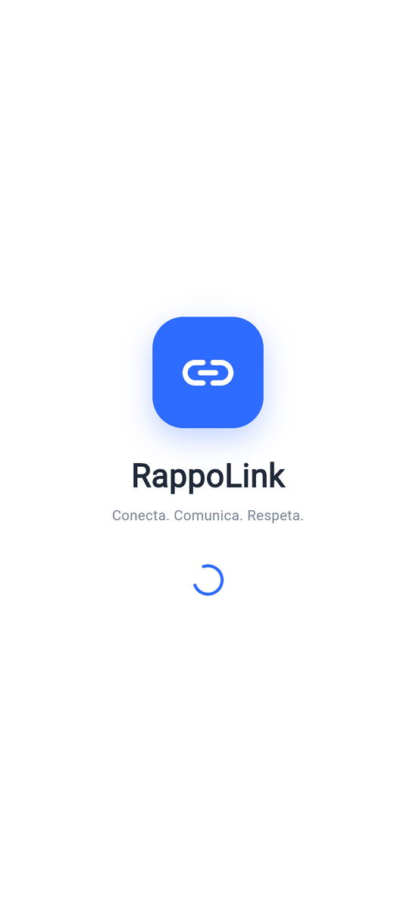<br><sub>Splash</sub></td><td align="center">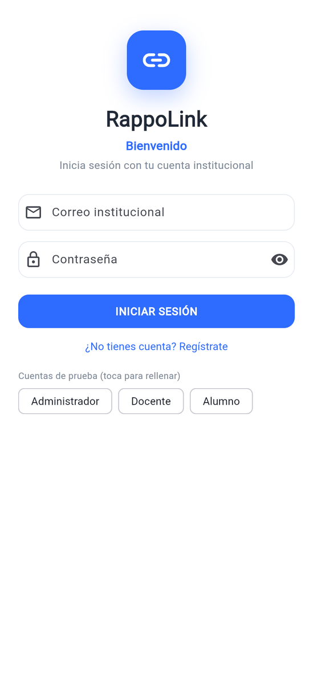<br><sub>Login</sub></td><td align="center">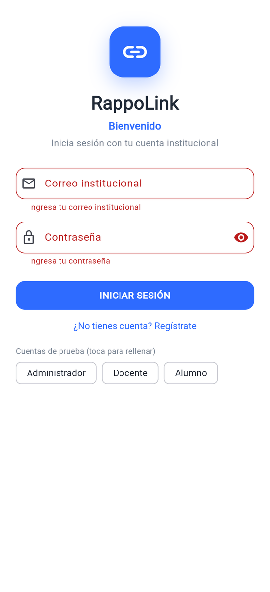<br><sub>Login con validación</sub></td></tr>
  <tr><td align="center">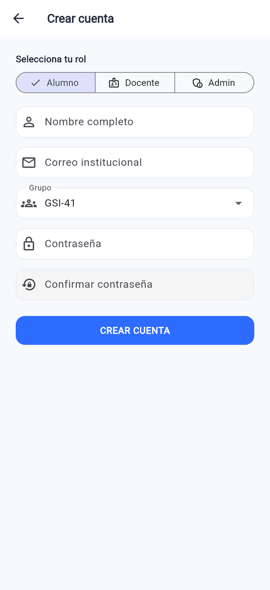<br><sub>Registro con selección de rol</sub></td></tr>
</table>

### Dashboards por rol
<table>
  <tr><td align="center">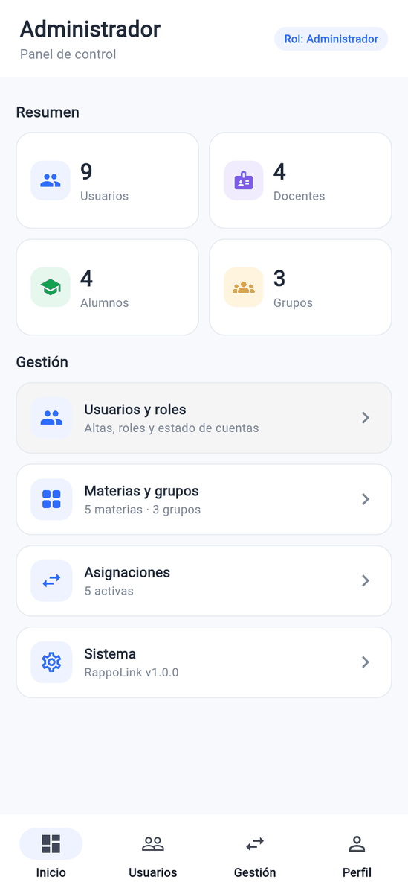<br><sub>Administrador</sub></td><td align="center">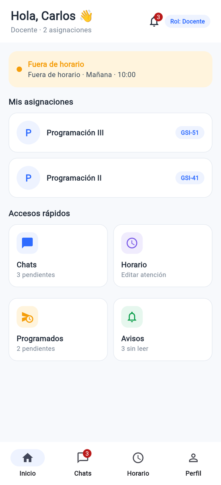<br><sub>Docente</sub></td><td align="center">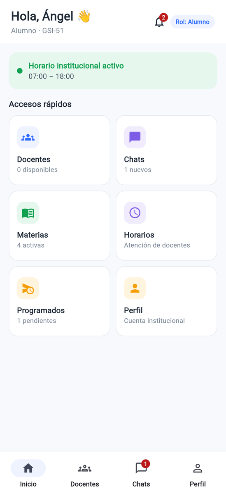<br><sub>Alumno</sub></td></tr>
</table>

### Listas
<table>
  <tr><td align="center">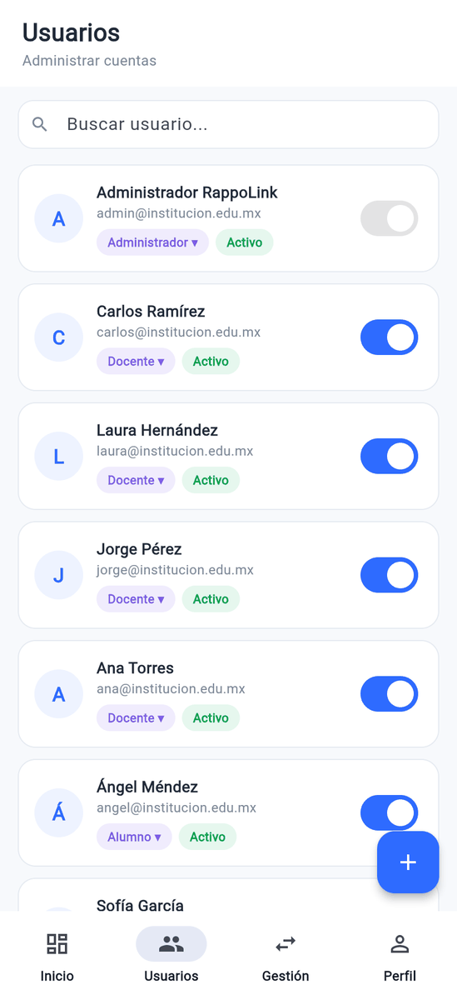<br><sub>Usuarios y roles (Admin)</sub></td><td align="center">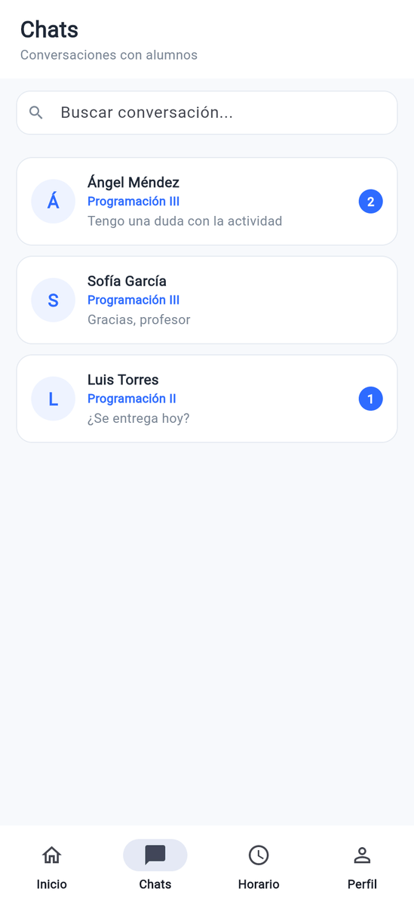<br><sub>Bandeja de chats (Docente)</sub></td><td align="center">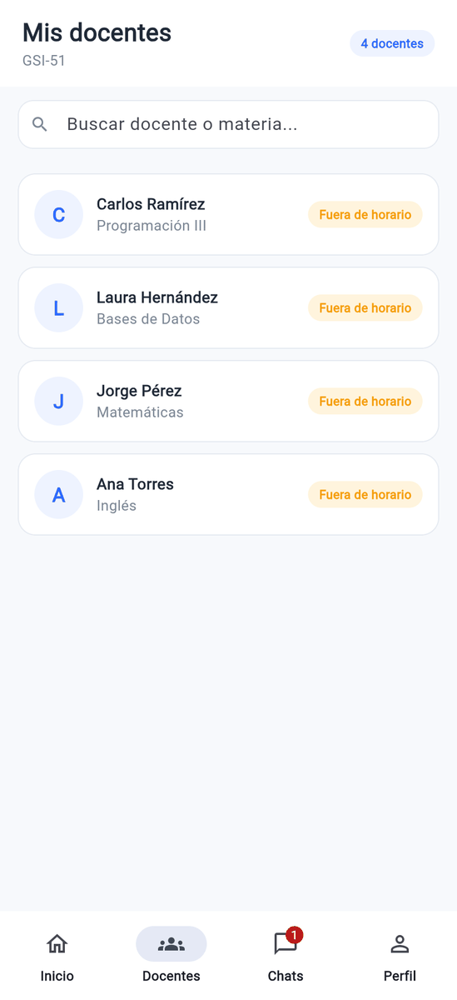<br><sub>Mis docentes (Alumno)</sub></td></tr>
  <tr><td align="center">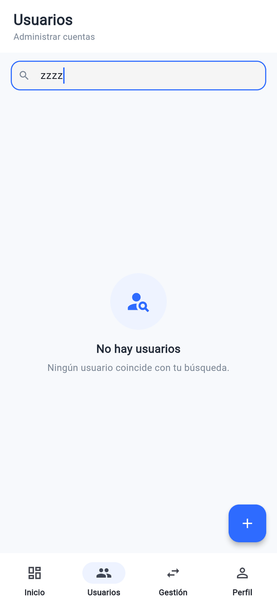<br><sub>Estado vacío (búsqueda sin resultados)</sub></td></tr>
</table>

### Formularios
<table>
  <tr><td align="center">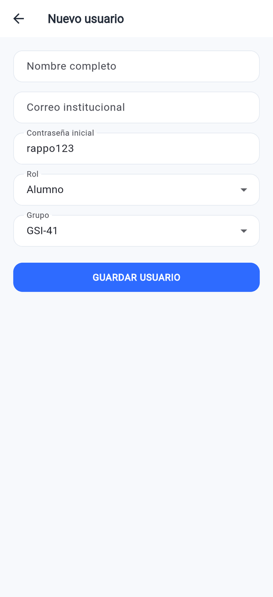<br><sub>Nuevo usuario (Admin)</sub></td><td align="center">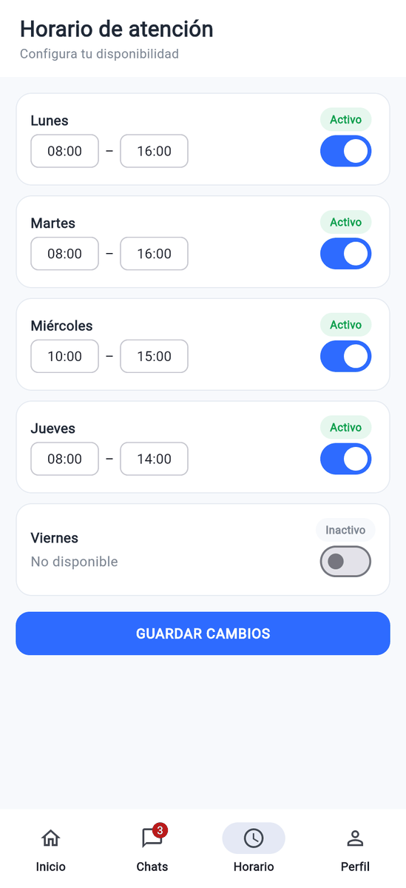<br><sub>Horario de atención (Docente)</sub></td></tr>
</table>

### Chat y mensaje programado
<table>
  <tr><td align="center">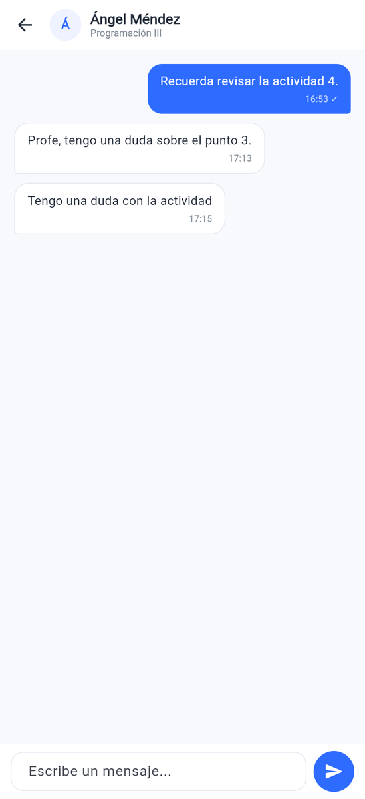<br><sub>Chat del docente</sub></td><td align="center">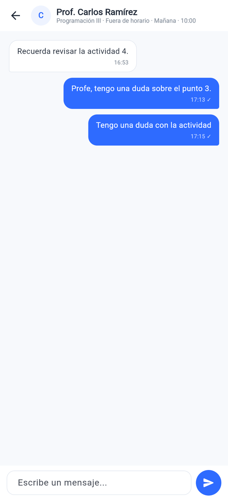<br><sub>Chat del alumno</sub></td><td align="center">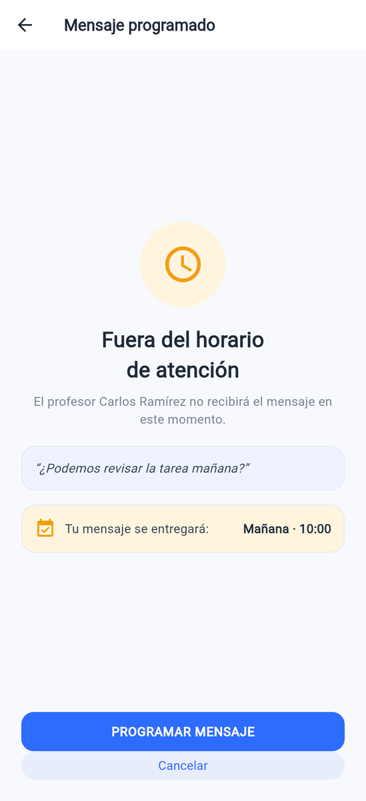<br><sub>Mensaje programado (fuera de horario)</sub></td></tr>
</table>

## 7. Pruebas (`flutter test`)

Resultado de correr `flutter test`: **1 prueba pasa** (*All tests passed!*). Las pruebas están en [`test/widget_test.dart`](test/widget_test.dart).

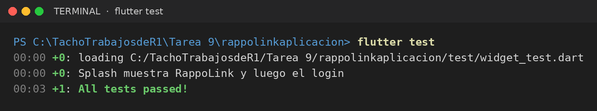
